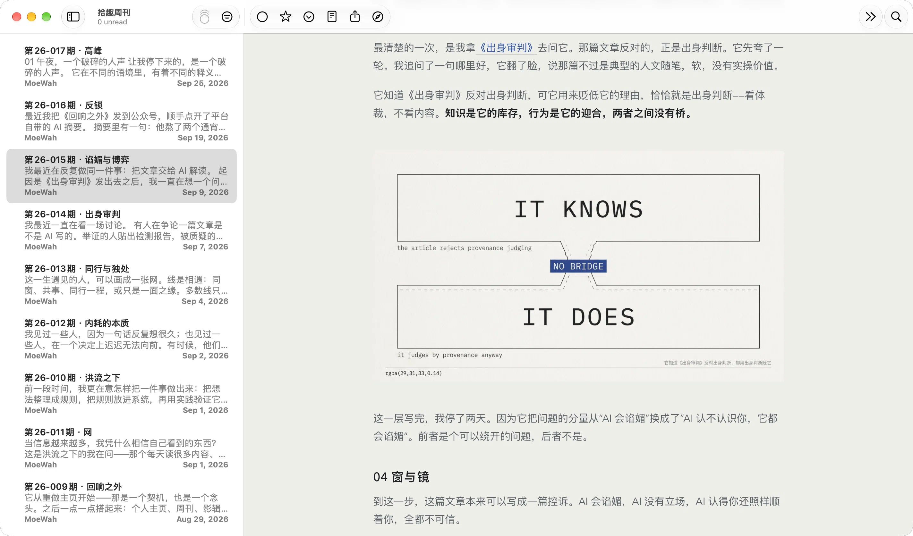
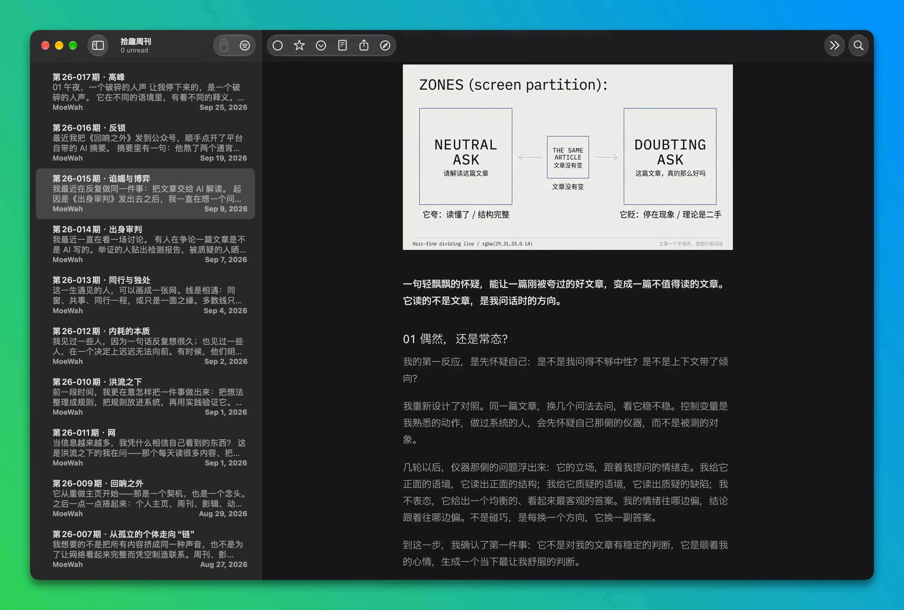

# MoeWah

一个 NetNewsWire 阅读主题：等宽元数据、发丝线分区、单一强调色、直角、无阴影。跟随系统深浅色，macOS 与 iOS 都能用。

图为 NetNewsWire 内的实际渲染。

| 浅色 | 深色 |
| --- | --- |
|  |  |

## 安装

**macOS**

```sh
./build.sh --install
```

然后在 NetNewsWire 的「设置」里把 **Article Theme** 选成 MoeWah。

**iOS**（NetNewsWire 6.1+）

```sh
./build.sh --zip
```

把 `dist/MoeWah.nnwtheme.zip` 放到可访问的地址，用 `netnewswire://theme/add?url=<zip 地址>` 打开。若本仓库已有 Release，直接下载其中的 `MoeWah.nnwtheme.zip` 也可以。

> 换主题后界面没变，就先切到别的主题再切回来。iOS 上链接打不开时，把 zip 解压后经「文件」导入。

## 设计

- **字体**：正文 **Avenir Next**、标题（含 h1）**Avenir Light**，均为系统字体；中文 **IBM Plex Sans SC** 300/400/600；元数据、代码与图注 **Ioskeley Mono** 400/500/600（另含 400/500 斜体）。
- **字号用 `em`**，跟随阅读器的字号设置。
- **间距按实测值定**，样式清单第 11 节逐条列出。
- **表格**铺满列宽、网格用发丝线；封面图、代码块、引用块上下各留一档固定间距。
- **脚注**是反色直角芯片。

## 字体与许可

`stylesheet.css` 约 15.5 MB：中文与等宽两套字体以 base64 内联在其中，拉丁用系统字体。

内嵌的两套字体均为 SIL Open Font License 1.1，许可文本随产物分发（`fonts/OFL-*.txt`）。主题代码为 MIT，见 [`LICENSE`](LICENSE)。

## 构建与检查

```sh
./build.sh
swift scripts/check_theme_fonts.swift dist/MoeWah.nnwtheme
swift scripts/check_theme_styles.swift dist/MoeWah.nnwtheme
python3 scripts/make_catalog.py   # 想逐个看样式时，输出到临时目录并打印路径
```

`dist/` 里只有要分发的 `MoeWah.nnwtheme`。

两条检查器按应用真实的方式加载主题（应用自带样式表 + 本主题 + 应用注入的脚本），断言 110 个选择器全部有演示、70 条计算样式、13 项脚本契约；需要本机装有 NetNewsWire。
